<!-- GENERATED by tools/generate_manuals.py from bomb/puzzle_data.py and bomb/glyphs.py. Do not edit by hand; re-run the generator. -->

# Player 2

You should also have paper/pencil, and a ruler.

## Mazes

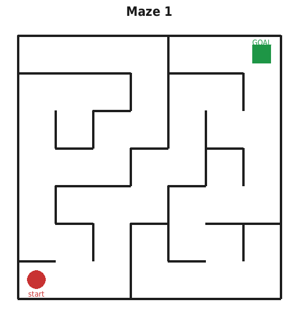

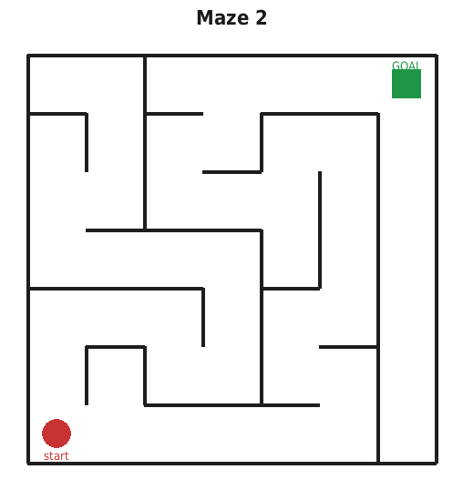

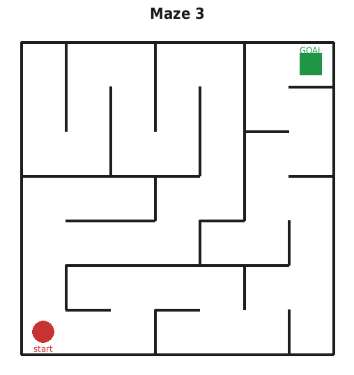

## Trail Map

Use the ruler against the scale bar for distances, and the protractor for bearings (degrees clockwise from North).

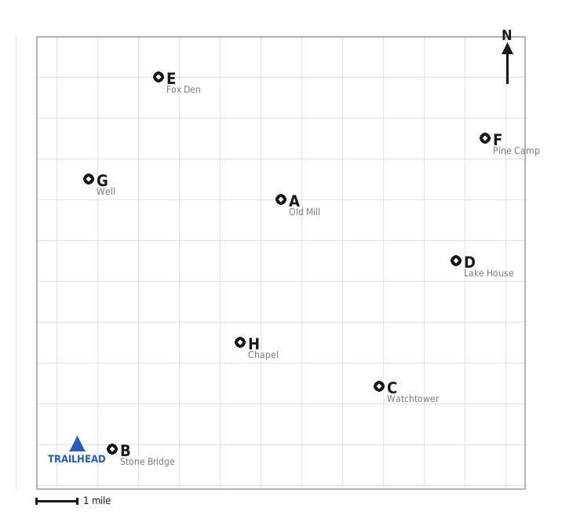

## Symbol Values

| Symbol | Name | Value | | Symbol | Name | Value |
| :---: | --- | :---: | --- | :---: | --- | :---: |
| 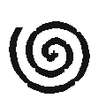 | Spiral | 1 |  | 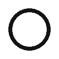 | Circle | 2 |
|  | Crescent | 3 |  |  | Square | 4 |
| 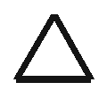 | Triangle | 5 |  |  | Pentagon | 6 |
|  | Star | 7 |  |  | Heart | 8 |
|  | Arrow | 9 |  |  | Cross | 10 |

## Junction Boxes

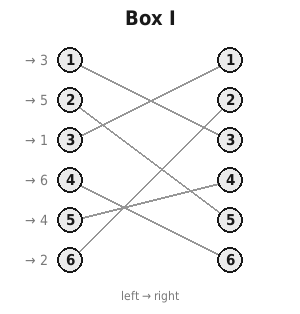

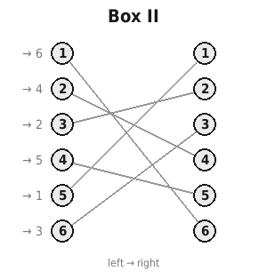

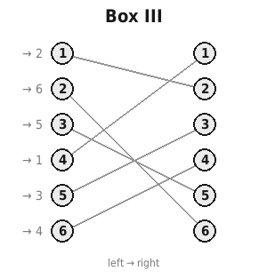

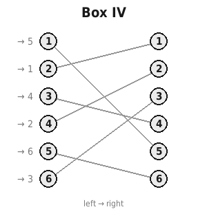

## Coordinate Grid

Plot each segment Player 1 reads as a point `(x, y)` joined to the next, then read off the picture they draw. (x across, y up.)

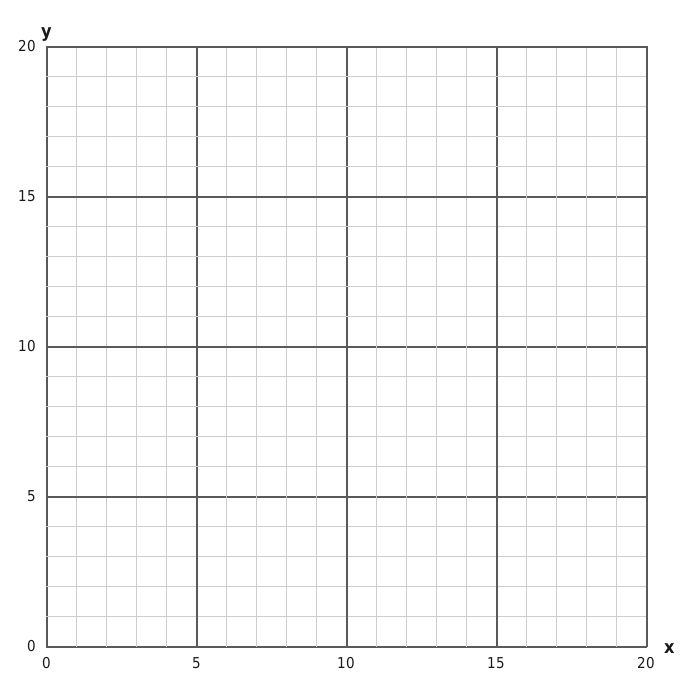
