<!-- GENERATED by tools/generate_manuals.py from bomb/puzzle_data.py and bomb/glyphs.py. Do not edit by hand; re-run the generator. -->

# Player 2 - Field Manual

> **Bomb Diffusal Activity.** Player 2 operates the two RGB LEDs, the four coloured buttons (Red, Yellow, Green, Blue) and the rotary encoder. Player 1 reads the screen to you; you look things up here and call out what to do. **Do not let Player 1 see this manual.**

You will also need the physical tools tucked into this manual:

- a printed **ruler** marked in the map's scale, and
- a printed **protractor** (0-360 degrees).

> _[PLACEHOLDER: print the ruler and protractor on transparent film and attach them to the inside cover. The ruler's scale must match the map's 1-mile bar.]_

## Section 1 - Mazes (Puzzle 4: Invisible Maze)

Player 1's screen shows a dot and a goal but **no walls**, and a label **“Maze 1/2/3”**. Find the matching maze below. The red dot is the start; the green square is the goal. Call out each move (up/down/left/right). Player 1 cannot move through a wall.

### Maze 1

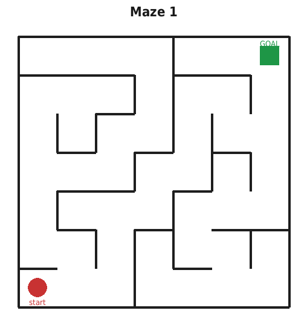

### Maze 2

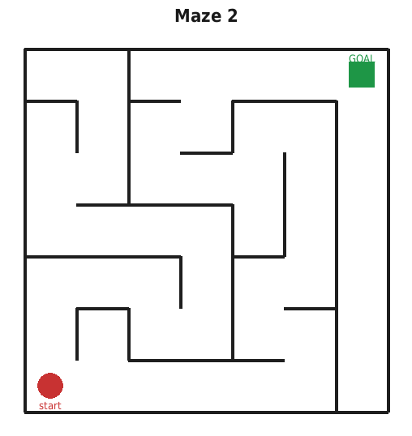

### Maze 3

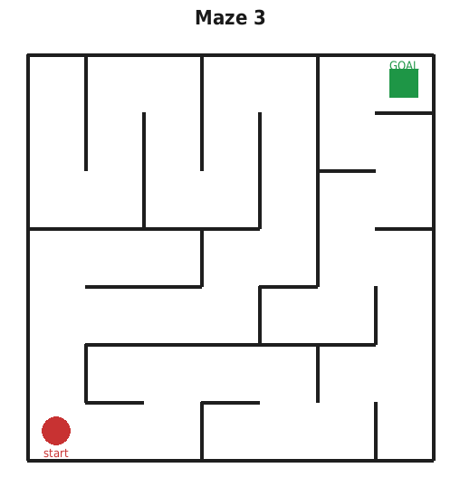

## Section 2 - Trail Map (Puzzle 5: Navigation)

Player 1 reads you a list of directions from the **trailhead** (blue triangle). Use the ruler and protractor to trace the route on this map, then tell Player 1 the **letter** of the landmark where the trail ends.

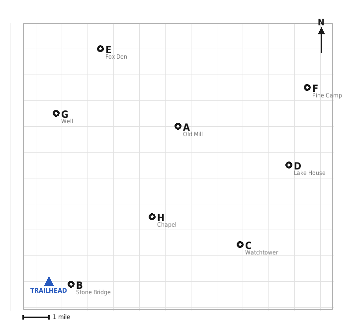

**How to measure:** bearings are compass degrees (0 deg = North, measured clockwise). Place the protractor's centre on your current point, set 0 deg to North, and turn by the stated angle. Measure distance with the ruler against the 1-mile scale bar.

**Landmarks:**

| Letter | Landmark |
| :---: | --- |
| **A** | Old Mill |
| **B** | Stone Bridge |
| **C** | Watchtower |
| **D** | Lake House |
| **E** | Fox Den |
| **F** | Pine Camp |
| **G** | Well |
| **H** | Chapel |

## Section 3 - Symbol Traits (Puzzle 8: Symbols Lock)

The screen shows five symbols; **four share one hidden trait** and one does not. Player 1 names the symbols (see their Symbol Names card); look each one up below and find the trait four of them share. The **odd one out** is the answer Player 1 clicks.

The hidden trait is always one of these:

- Same number of strokes
- All curved (no straight edges)
- All symmetrical (have a mirror line)
- All closed shapes (fully enclose an area)

| Symbol | Name | Strokes | Curved | Symmetrical | Closed |
| :---: | --- | :---: | :---: | :---: | :---: |
| 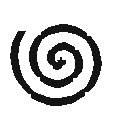 | Spiral | 1 | yes | no | no |
| 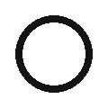 | Circle | 1 | yes | yes | yes |
|  | Crescent | 2 | yes | no | yes |
|  | Square | 4 | no | yes | yes |
| 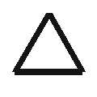 | Triangle | 3 | no | yes | yes |
| 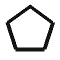 | Pentagon | 5 | no | yes | yes |
|  | Star | 5 | no | yes | yes |
|  | Heart | 3 | yes | yes | yes |
|  | Arrow | 3 | no | yes | no |
| 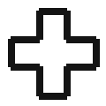 | Plus | 3 | no | yes | no |

## Section 4 - Symbol Values (Puzzle 9: Glyph Addition)

The screen shows an equation made of symbols. Player 1 reads it out; look up each symbol's number here, do the arithmetic, and give Player 1 the total to type.

| Symbol | Name | Value | | Symbol | Name | Value |
| :---: | --- | :---: | --- | :---: | --- | :---: |
|  | Spiral | 1 |  |  | Circle | 2 |
|  | Crescent | 3 |  |  | Square | 4 |
|  | Triangle | 5 |  |  | Pentagon | 6 |
|  | Star | 7 |  |  | Heart | 8 |
|  | Arrow | 9 |  |  | Plus | 10 |

## Section 5 - Circuit Diagrams (Puzzle 6: Turn on the LED)

Player 1's screen shows the same circuit but with the gate boxes **numbered and blank**, plus a label **“Circuit ALPHA/BRAVO/CICERO”**. Find the matching diagram below - it tells you which gate each numbered box is. Work out which input switches (0/1) make the output lamp light, and tell Player 1 which switches to toggle.

Gate reminders: **AND** = on only if both inputs on. **OR** = on if either input on. **XOR** = on if the inputs differ. **NOT** = flips its one input.

### Circuit ALPHA

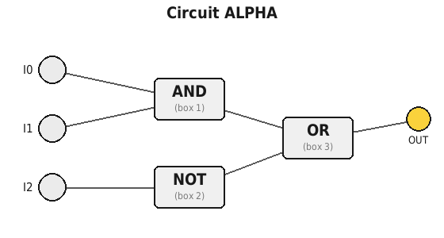

### Circuit BRAVO

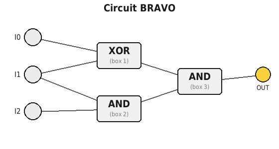

### Circuit CICERO

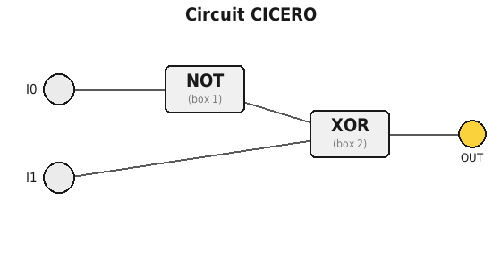
